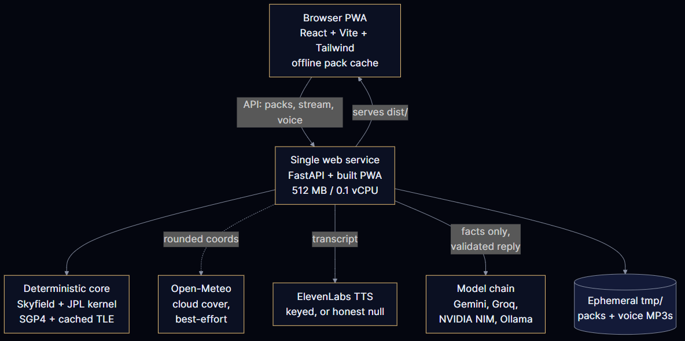

# SkyWhisper

Screenless astronomy. Prepare a narration of tonight's sky at home, download it, then go outside with the phone face-down and listen.



## What it does

A location and time go in; an audio pack comes out. The server computes exactly what is overhead — Sun, Moon, planets, named stars, satellite passes — using a deterministic ephemeris engine, turns those computed facts into a spoken narration, and renders audio. Outside, the pack plays with the screen off through lock-screen controls.

Coordinates are never guessed, and no language model is allowed to compute a position. The model only narrates facts the ephemeris already produced, and every number it utters is checked against that computed set before audio is rendered. When no model is configured, a deterministic template narrator produces the same validated prose with zero external calls.

## Architecture

```
src/
├── core/              # Pure astronomy math (no I/O, unit-testable)
├── backend/           # FastAPI server
│   ├── api/           # Snapshot, packs (+SSE stream), voice answers
│   ├── core/          # Skyfield ephemeris → SkySnapshot (+ satellite passes)
│   ├── narration/     # Template narrator, chain router, anti-hallucination validator
│   ├── mastra/        # Mastra agent harness (tools → docent agent → validate)
│   ├── audio/         # ElevenLabs TTS, or an honest null
│   └── services/      # Open-Meteo weather, CelesTrak TLE + SGP4
├── frontend/          # React 19 + Vite + Tailwind v4 + Framer Motion + Three.js PWA
└── shared/            # Pydantic schemas
```

Application code lives in `src/`. Docs, tests, and deployment files live outside it. The full data-flow diagrams live in [docs/architecture.md](docs/architecture.md), with sources in [docs/code](docs/code) and renders in [docs/asset](docs/asset).

## Run locally

Backend — one process, serves the API and the built frontend:

```bash
pip install -r requirements.txt
uvicorn src.backend.api.routes:app --host 0.0.0.0 --port 8080
```

Frontend dev server (proxies `/api` to `:8080`):

```bash
cd src/frontend
npm install
npm run dev
```

Mastra harness (needed only for model orchestration; the backend degrades
to direct HTTPS without it):

```bash
cd src/backend/mastra
npm ci && npm run build && npm run selftest
```

With no environment variables set, the server uses the deterministic template narrator and no TTS. Zero external calls — it works on a laptop with no internet.

Environment variables are optional. See [.env.example](.env.example):

| Variable | Purpose |
|---|---|
| `ELEVENLABS_API_KEY` | TTS audio. Without it, the transcript is the deliverable |
| `ELEVEN_VOICE_ID` | Voice selection |
| `LLM_PROVIDER` | `template` (default, $0) · `openai`/`gemma` (hosted chain) · `ollama` (local, or `LOCAL_INFERENCE=true`) |
| `GEMMA_API_KEY` / `GEMMA_BASE_URL` | Google AI Studio key + OpenAI-compatible endpoint |
| `GEMMA3_MODEL` / `GEMMA4_MODEL` | Chain rungs 1–2 (`GEMMA_MODEL` still works as the rung-1 fallback) |
| `GROQ_API_KEY` / `GROQ_MODEL` | Chain rung 3 |
| `NVIDIA_API_KEY` / `NVIDIA_MODEL` | Chain rung 4 |
| `OLLAMA_BASE_URL` / `OLLAMA_MODEL` | Local daemon for `LLM_PROVIDER=ollama` |
| `SKYWHISPER_EPHEMERIS` | JPL kernel name, cached under `data/ephemeris/` |

## Model chain

Narration runs an ordered fallback chain — first validated transcript wins, template narrator is the unbreakable last rung:

1. Gemini API (fast rung) → 2. Gemini API (large rung) → 3. Groq open-weight → 4. NVIDIA NIM → 5. template

Each rung carries a fallback model ID tried on 404/410-class errors, because providers retire names without warning. Each rung gets 55 seconds and the whole walk gets 150; past that the template answers rather than hanging. Hung harness subprocesses are killed, never orphaned. Each pack records which rung answered (`narration.provider`, `orchestrator`, `generation`) so the UI states exactly what narrated it — or why the template did.

## Voice control

A floating mic button enables hands-free control (browser Web Speech API — free, no key; screen-on listening, screen-off playback):

- **Describe:** "describe the sky", "how is it looking outside", "what's above me", "tell me about tonight" — generates (or replays) the pack and plays it
- **Replay / pause / play / louder / quieter** work by voice; anything else substantial goes to the agent as a spoken answer with conversation memory
- **Typed follow-ups** work in the same panel on browsers without mic support

**Dark compass:** from any pack, "Point at the Sky" opens a pure-black overlay (OLED-dark) where the compass, vibration, and rising pitch guide aim onto any visible body, with a spoken confirmation on lock. Screen-on is required — mobile browsers suspend sensors and audio capture on lock, so this is output-only by platform design.

## Testing

```bash
python -m pytest tests/ -q
```

136 tests: pure astronomy math, snapshot and narration validation (including anti-hallucination rejection and a regression suite built from real production failures), chain fallthrough with per-rung budgets, subprocess cleanup, satellite propagation and degradation, Mastra bridge contract and orchestration order, voice endpoint behavior, and HTTP integration (including the SSE pack stream). The suite is hermetic — no network, no provider keys — with one exception documented in the tests themselves: ephemeris/TLE fetches degrade to packaged data offline.

Frontend and harness checks (also enforced in CI):

```bash
cd src/frontend && npm ci && npx tsc -b && npx vite build
cd ../backend/mastra && npm ci && npm run build && npm run selftest
```

Manual end-to-end checklist before release:

1. `curl -s http://127.0.0.1:8080/api/health` returns `ok`.
2. Prepare a pack in the UI for a real location; confirm the narration names bodies that are actually up (cross-check one against any planetarium).
3. With airplane mode on, reload: the shell loads and a downloaded pack still plays.
4. With a model key set, confirm the pack's generation record names the rung — then revoke the key and confirm the template still ships.

## Deploy

One free web service (Dockerfile, or `render.yaml` Blueprint) serving the API and the built PWA from the same process — 512 MB RAM, 0.1 vCPU. Set secrets in the dashboard, never in git. See [docs/deployment.md](docs/deployment.md).

## Accuracy

Positions were cross-checked against astropy's independent implementation. All agreed to 0.00° except the Moon's elongation (0.64°, from its ecliptic latitude). Full table and method in [docs/accuracy.md](docs/accuracy.md).

Twilight bands follow USNO conventions. Moon illumination is `(1 − cos E) / 2` from the Sun–Moon elongation. Directions are spoken as fist-widths (1 fist ≈ 10°) and compass names — never raw coordinates.

## Docs

- [architecture.md](docs/architecture.md) — layout, request flow, diagrams
- [api.md](docs/api.md) — endpoint reference
- [accuracy.md](docs/accuracy.md) — verification method and cross-check table
- [deployment.md](docs/deployment.md) — Render, Docker, local
- [stack.md](docs/stack.md) — every dependency and its license
- [privacy.md](docs/privacy.md) — what leaves your device
- [development-log.md](docs/development-log.md) — bugs found and fixed

## Safety

Do not walk while listening. Stay away from roads, water, cliffs, and traffic. This is an astronomy companion, not a navigation tool.

## License

Apache-2.0. See [LICENSE](LICENSE).
