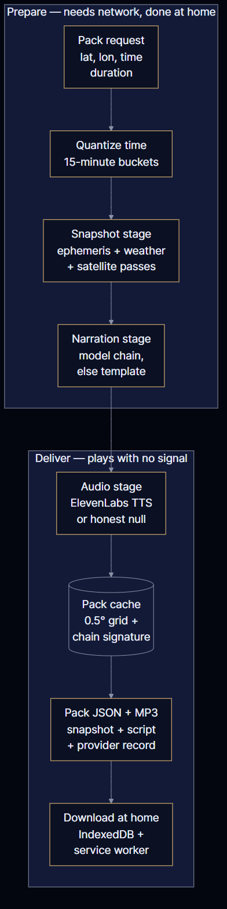
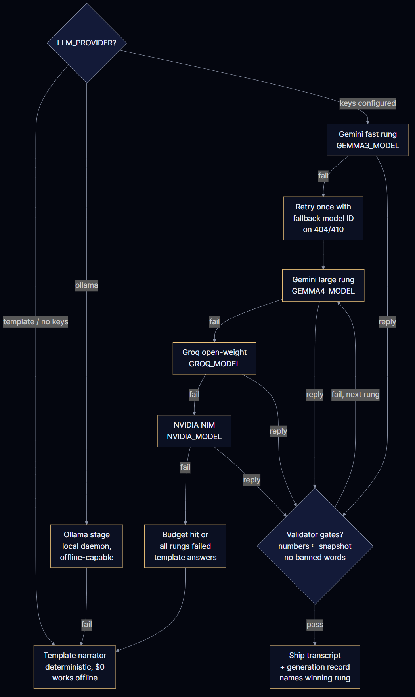
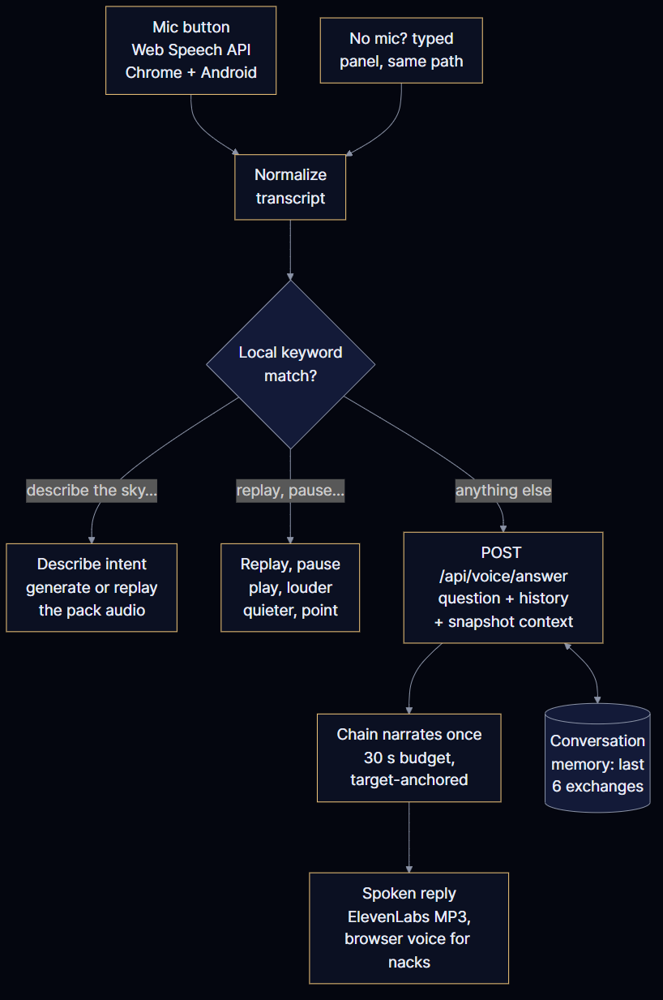
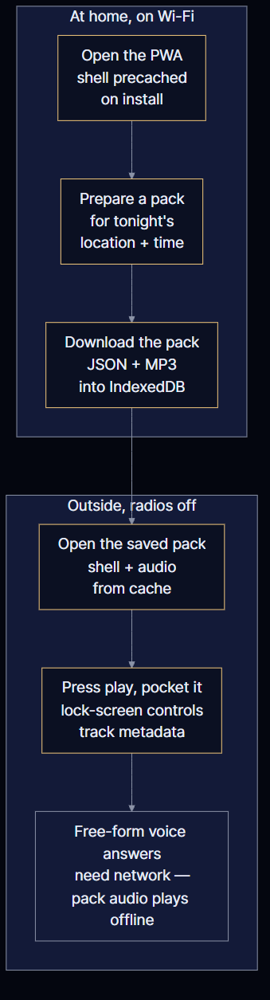

# Architecture

SkyWhisper turns astronomy into a listening activity. All computation happens
before you go outside; the field artifact is an audio pack, not an app screen.

## Layout

```
src/
├── core/              # Pure astronomy math (no I/O, unit-testable in isolation)
├── backend/           # FastAPI server
│   ├── api/           # Routes: snapshot, packs (+SSE stream), voice answers
│   ├── core/          # Skyfield ephemeris → SkySnapshot (+ satellite passes)
│   ├── narration/     # Template narrator, Mastra bridge, anti-hallucination validator
│   ├── mastra/        # Mastra agent harness (facts → docent agent → validate workflow)
│   ├── audio/         # ElevenLabs TTS (honest null when unconfigured)
│   └── services/      # Open-Meteo weather, CelesTrak TLE + SGP4
├── frontend/          # React 19 + Vite + Tailwind v4 + Framer Motion PWA
└── shared/            # Pydantic schemas — request + SkySnapshot contract
```

Application code lives under `src/`. Docs, tests, deployment files, and data
live outside it.

## Request flow

```
client ──POST /api/packs ──▶ routes.py
         or GET /api/packs/stream (same stages, streamed)
                               │
                               ▼
                     core/astronomy.py      Skyfield ephemeris
                               │            (deterministic, no LLM)
                               ▼
                        SkySnapshot          the single source of truth
                               │
               ┌───────────────┴───────────────┐
               ▼                               ▼
    services/weather.py              narration chain (ordered)
    services/satellites.py           Mastra workflow per rung, then
    (both best-effort)               direct HTTPS — every number gated
                                     by validate_narration(); template
                                     fallback can never be skipped
               │                               │
               └───────────────┬───────────────┘
                               ▼
                      audio/tts.py            ElevenLabs, or honest null
                               ▼
                   pack JSON + MP3 (cached)
                               │
                               ▼
                     client Cache Storage / download
```

Timestamps floor to 15-minute buckets before compute, so requests minutes
apart share one cache entry instead of rebuilding the same sky from zero.

## The model chain

Ordered rungs, first validated transcript wins: Gemini fast → Gemini
large → Groq → NVIDIA NIM → template. Each rung carries a fallback model
ID tried on 404/410-class errors (providers retire names without warning),
each rung gets 40 seconds, and the whole walk gets 100 — past that the
template answers rather than hanging. Tight on purpose: a pack that
outlives the hosting proxy's request window dies mid-stream and the user
sees nothing for two attempts, so slow rungs fail fast and the healthy
rungs behind them still get their turn. Every pack records which rung
answered and why the others did not (`narration.provider`,
`orchestrator`, `generation`), and the UI surfaces it. Voice answers run
the direct-HTTPS rungs only (no harness spawn — a Node cold-start costs
more than a voice answer's whole budget) under a 55-second hard cap, then
the template answers; the endpoint carries the listener's question and
recent exchange as context.

## Voice loop

Mic tap → browser speech recognition → local keyword intents (describe,
replay, pause, volume, wake) handled on-device → anything else substantial
goes to `POST /api/voice/answer` → chain narration → TTS MP3 → playback,
with the transcript always shown. Listening needs the screen on (a platform
constraint, stated in the UI); playback survives screen-off via Media
Session. A dark-compass overlay (compass + haptics + pitch, zero emitted
light that matters) guides aiming without a visible screen.

## Separation of coordinates from narration

The language model never computes a position. `SkySnapshot` is built entirely
by `core/astronomy.py` from Skyfield. Only the finished snapshot reaches the
narrator, and every number the narrator utters is checked against
`snapshot_facts()` by `validate_narration()` before audio is rendered. An
unapproved number or a raw coordinate phrase blocks the script.

## Provider abstraction

`audio/tts.py` returns a `TTSResult` that is honestly unavailable when no key
is set — it never returns fake bytes. Narration has a deterministic template
path that needs zero external services, so the pack always ships.

## Single service

Render's free tier provides one web service. The FastAPI process serves both
`/api/*` and the built PWA from `src/frontend/dist`, so there is exactly one
instance to run and one cold start to absorb.

## Memory notes

Serving footprint runs roughly 80–120 MB steady state: Python/FastAPI plus
the memory-mapped ephemeris (the ~16 MB kernel contributes only a few MB
resident). The Mastra harness spawns Node only while a model rung is
running (~220 MB transient), so template-mode traffic never pays for it.
One uvicorn worker, one harness spawn per pack, subprocesses killed on
timeout — no worker-count multiplier, no orphan accumulation on 512 MB.

## Diagrams

Sources live in [code](code) (Mermaid, rendered with the toolchain in
`code/package.json`); renders live in [asset](asset) as 1200×1200 PNGs.


One free web service: the browser PWA talks to FastAPI, which owns the
deterministic core and fans out to best-effort weather, keyed TTS, and the
model chain. Media lands on the ephemeral disk.



Prepare needs network and happens at home; delivery plays with no signal.
Snapshot, narration, then audio — over one POST or streamed as SSE stages.



First validated transcript wins; the template narrator is the unbreakable
last rung. Each rung retries once with its fallback model ID on 404/410,
because providers retire names without warning.



Free browser speech-to-text, keyword intents matched locally, free-form
questions answered by the chain with conversation memory.



The service worker precaches the shell; pack audio and transcripts are
stale-while-revalidate. Free-form voice answers are server-side and
ephemeral, so they stay home — the downloaded pack is the field
deliverable.

## Verification

Positions were cross-checked against astropy `get_body()` during development:

| Quantity | SkyWhisper | astropy | Delta |
|---|---|---|---|
| Sun altitude (verification epoch, 22.5726 N) | -73.08° | -73.08° | 0.00° |
| Moon altitude | -45.16° | -45.16° | 0.00° |
| Moon elongation | 35.25° | 35.89° | 0.64° |
| Jupiter altitude | -27.11° | -27.11° | 0.00° |
| Saturn altitude | 69.02° | 69.02° | 0.00° |

The elongation residual comes from the Moon's ~5° ecliptic latitude, which
the 2D ecliptic projection used for phase bucketing ignores. It is far
inside the tolerance for naming a lunar phase, and the illumination fraction
it produces (0.092 vs 0.095) rounds to the same bucket.
